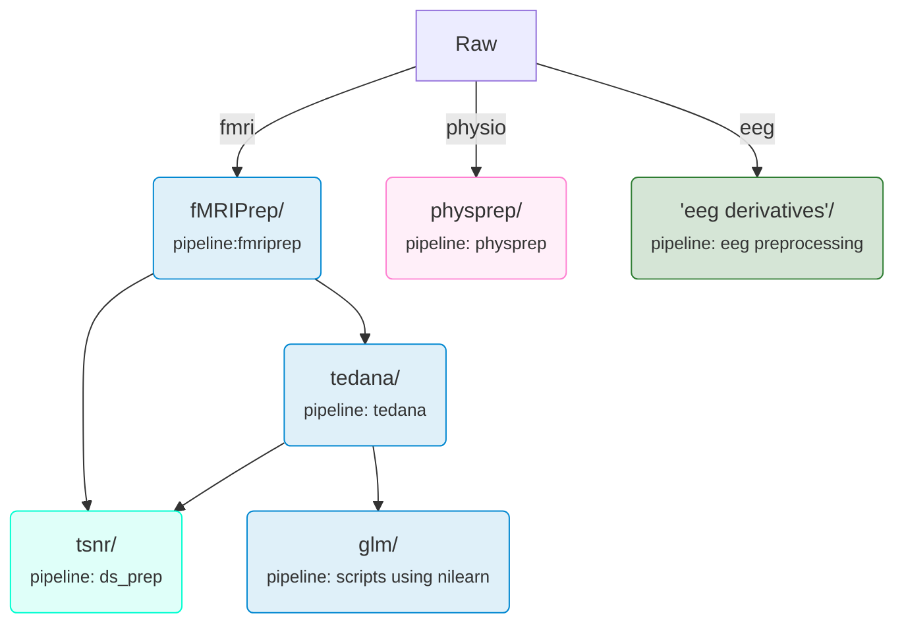

# Data structure

repère pour savoir où sont les données


## Raw


TODO : make a tree of the data
data --/| 


## Derivatives


---
### fmriprep 
#irmf

### Tedana 
#irmf

### GLM
#irmf

### Physprep

filenames : `*desc-prepro*` What it is blablabla
after manual corerction `*desc-feature*` blablabla

### EEG (name of pipeline, e.g. MNE)

---

# Data management

DataLad is used to track the provenance of all data. DataLad is a data management system build on top of git and git-annex (Halchenko et al., 2024). 

The data are organized following the Brain Imaging Data Structure (Gorgolewski et al., 2016), providing guidelines for the structure of raw and derivatives data (see the Data organization section).

## Data organization

This section summarizes the data organization for two main types of data, namely raw data and derivatives data. The logic of such organization is derived from the BIDS principles. For more information regarding the difference between raw and derivatives data, as well as principles related to derivatives data storage, please look at the [BIDS specification documentation](https://bids-specification.readthedocs.io/en/stable/common-principles.html#source-vs-raw-vs-derived-data).

### Raw data

Raw data in BIDS format across all experimental sessions are organized in the same folder following the BIDS specification. 

### Derivatives data

All data that are derived from the raw data (i.e., preprocessed data, extracted features, etc.) or from other derivatives data (e.g., tsnr maps computed on the preprocessed bold images) are organized in different sub-folders under the `derivatives/` folder. The rules is that any time a new pipeline is used on the data, a new sub-folder should be created in `derivatives`. For example, running a specific version of fMRIPrep on the raw data would count as a pipeline. Running tedana on the fMRIPrep outputs would be another pipeline, and running the code to generate the tsnr maps on the fMRIPrep and tedana data would be a third pipeline, and glm outputs would be a fourth pipeline. The structure of those outputs are visualized below:


Figure 1 - Mermaid diagram providing an overview of the data structure. The rectangular box represents raw data, and the rounded boxes represent derivatives data.

## Data access

### For dataset users

See Onedrive in `ressources/project_orientation.md` for team specific procedures, such as compute server access.

### For the research team

The subsections below are targeted at the members of the research team working with the `pilot` or `dev` version of the data. If you are part of another research group and want to access the released version of the dataset, please go to the **For dataset users** section.

> [!NOTE]
> The specific paths are not mentioned directly in this documentation. If you need you don't have an account to access the servers or need any information regarding specific directory, please contact XX on XX.

#### Updating a dataset

The data are added to the submodules as they are acquired. A branch is created at the subject level and is merged into the `pilot` branch (for pilot data) or in the `dev` branch (for data acquired using the final acquisition parameters and experimental design). This means that the submodules installed on the server need to be updated as we go to have access to the most recent participant. The instructions to update the submodules (e.g., `tedana/`) are detailed below:

1. Open a terminal and connect to the server
2. Go to the submodule directory
```
cd /path/to/submodule
```
3. Make sure you are using the right branch
```
git branch -a
```
4. [optional] Change branch if needed
```
git checkout <branch>
```
5. Fetch the updates. You need to make sure you have write permission on the `.git/FETCH_HEAD file` in the submodule, otherwise the following command will not work.
```
datalad update --how fetch
```
6. Merge the updates 
```
datalad update --how merge
```
7. Export your access key
```
export AWS_ACCESS_KEY_ID=<your_id> AWS_SECRET_ACCESS_KEY=<your_access_key>
```
8. Retrieve the content of the files
```
datalad get <specific files/directory>
```
<br>

> [!NOTE] Note: Troubleshoot
> If the commands above are not working, run:
> ```
> ssh-add -l
> ```
> This will show you the SSH keys that are loaded in your active SSH agent.
> 
> If you have the following message, *Could not open a connection to your authentication agent.*, that means that your SSH agent is not running. In that case, enter the following command:
> ```
> eval "$(ssh-agent -s)"
> ```
> If getting a `The agent as no identies` message, make sure you followed the procedures to [configure the ssh key with your gitlab account](https://docs.gitlab.com/user/ssh/?tab=Linux+%28requires+the+xclip+package%29) 
>
> Now you will need to add your key to the running agent specifying your private key file:
> ```
> ssh-add ~/.ssh/<your_private_key_file>
> ```
> 
> Finally, to validate your connection, run the following command first replacing the subdomain:
> ```
> ssh -T -p 222 git@gitlab.<subdomain>.ca
> ```
> You should see a "Welcome to GitLab" message :tada: 

#### Adding derivatives to the dataset

